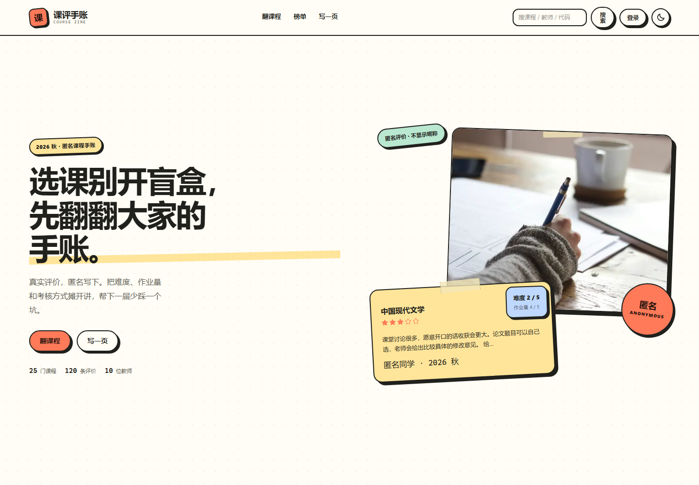
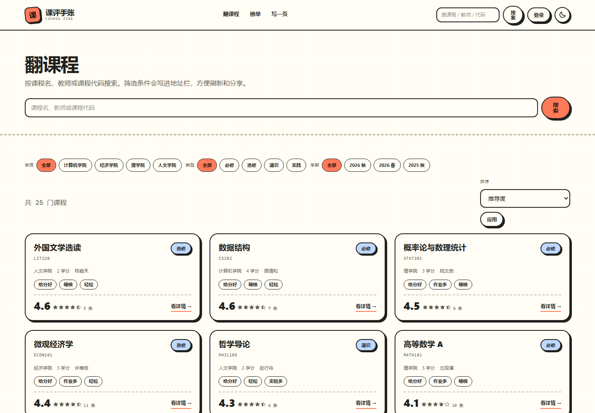
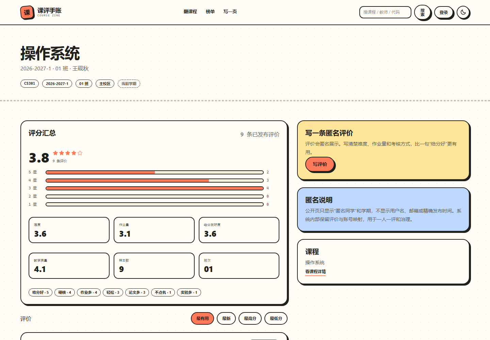
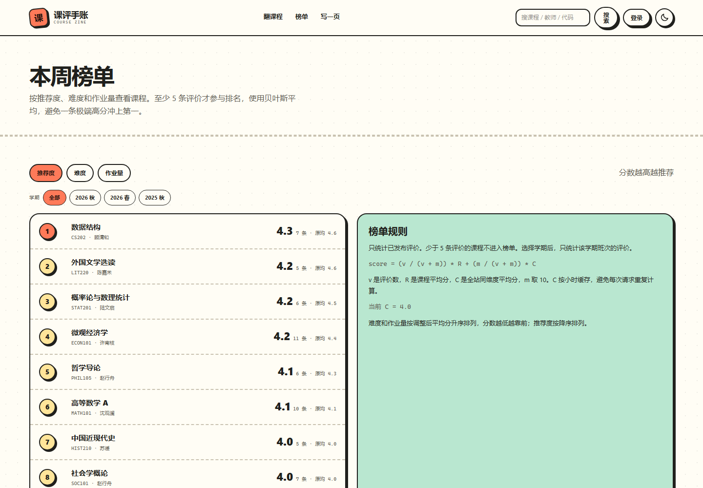
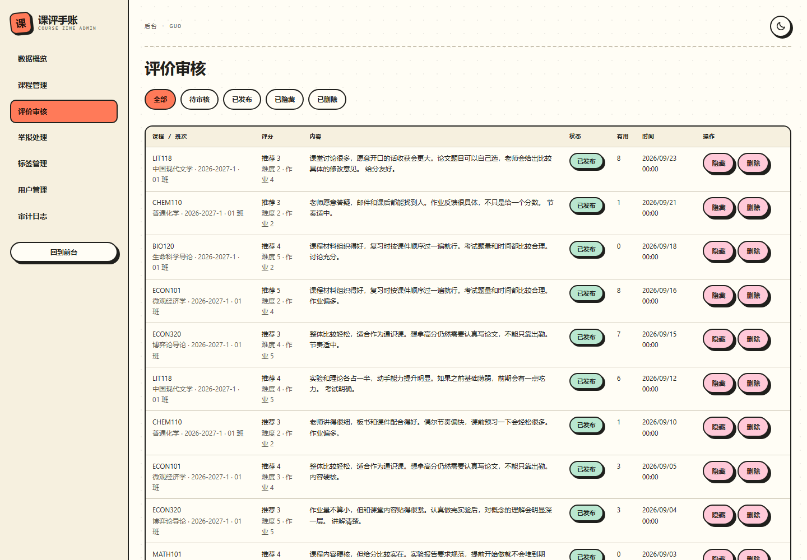
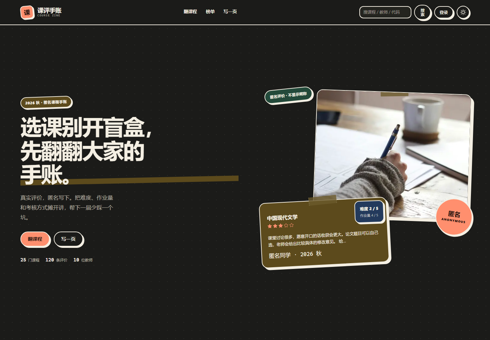
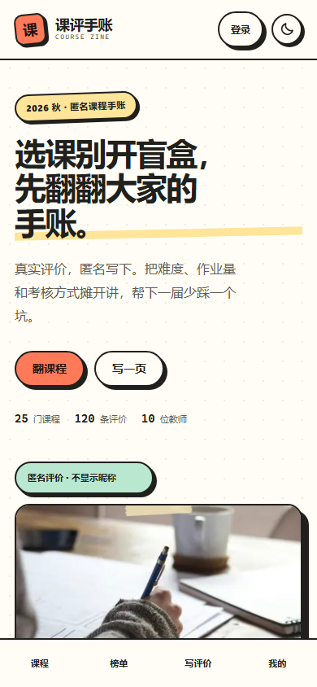

# 课评手账 · Course Zine

课评手账是一个面向学生的匿名课程评价站。评价挂在具体的开课班次上，记录难度、作业量、推荐度、考核方式和文字体验，帮下一届学生在选课前看到更具体的信息。

## 界面

| 首页 | 课程库 |
| --- | --- |
|  |  |
| **班次评价** | **排行榜** |
|  |  |
| **后台审核** | **暗色模式** |
|  |  |

<p align="center">
  
</p>

## 能做什么

**浏览课程**

按课程名、教师或课程代码搜索。可以按学院、课程类型和学期筛选，条件会写进地址栏。课程页把同一门课的多个班次放在一起，班次页只展示这个学期和教师的评价。

**写一条匿名评价**

难度、作业量、推荐度是必填项，给分友好度和教学质量可以选填。考核方式支持多选，标签从预设列表里选。正文最少 10 个字，最多 2000 字。同一班次只能写一条，发布后 7 天内可以修改，也可以删除。

**匿名和治理**

公开页面只显示“匿名同学”和学期，不显示用户名、邮箱或精确发布时间。评价正文和作者映射分表存储，公开查询不会读取作者表。少于 5 条评价时，不显示平均分和分布图。登录用户可以点有用或举报，不能给自己的评价投票。管理员可以隐藏、恢复或删除评价，处理举报，并把操作写入审计日志。

**排行榜**

推荐度、难度和作业量三个维度，使用贝叶斯平均，至少 5 条评价才进入榜单，可以按学期筛选。难度和作业量按分数升序，推荐度按降序。

**后台**

课程和班次管理、CSV 导入、评价审核、举报处理、用户角色与封禁、标签管理、审计日志。后台沿用相同的颜色和边框，但去掉了便签旋转和胶带，保证表格和表单的可读性。

## 设计

页面使用奶油纸底色、2px 墨色描边、偏移阴影和珊瑚色单一强调色。首页和评价卡片保留了胶带、便签和轻微旋转，表单和后台收敛为规则的卡片、表格和胶囊按钮。字体使用系统字体栈，不加载外部字体。

## 技术栈

- Next.js 16 App Router、React 19、TypeScript
- Tailwind CSS 4、自定义 CSS token
- PostgreSQL 18、Prisma 7（`@prisma/adapter-pg`）
- Better Auth，用户名和密码登录
- Radix UI Dialog、Phosphor Icons、GSAP
- Zod、React Hook Form
- Biome

## 本地运行

1. 安装依赖：

```bat
npm install
```

2. 复制 `.env.example` 为 `.env`，填写 `DATABASE_URL`、`BETTER_AUTH_SECRET` 和 QQ 邮箱 SMTP 配置。

3. 应用数据库迁移：

```bat
npm run db:deploy
```

4. 创建本地管理员。脚本只创建 `guo` 账号，不会清空已有数据，密码读取 `.env` 里的 `ADMIN_PASSWORD`：

```bat
npm run db:seed
```

5. 启动：

```bat
npm run dev
```

打开 <http://127.0.0.1:3000>。管理员账号为 `guo`。

## 说明

- 项目只在本地运行，不包含部署配置。
- 截图使用本地数据库中的演示数据。课程、班次和评价只用于展示界面。
- 邮箱验证码通过 QQ SMTP 发送。默认 `EMAIL_DELIVERY_MODE=smtp`，需要真实发信；如果不想发信，可以改成 `log`，验证码只写服务端日志。
- `.env` 不提交，数据库密码和邮箱授权码只保存在本地。
